# StaffDesk – Personel İzin ve Zimmet Yönetimi API'si

 

Kurumlarda personelin **yıllık izin/mazeret/hastalık izin** süreçlerini ve **demirbaş zimmetlerini** yöneten REST API.
**Java 21, Spring Boot 3, Spring Data JPA (Hibernate), Spring Security (JWT), Flyway, PostgreSQL, JUnit 5** ile geliştirildi.

## Özellikler
- **İzin yönetimi:** talep → onay/red/iptal akışı; iş günü hesabı (hafta sonu ve resmi tatiller sayılmaz), çakışma kontrolü, yıllık izin bakiyesi ve hak ediş kuralı.
- **Zimmet yönetimi:** demirbaş kaydı, personele zimmetleme, iade, kayıttan düşme; tüm geçmiş korunur, aynı demirbaş aynı anda iki kişiye verilemez.
- **Roller ve yetki:** `ADMIN`, `MANAGER`, `EMPLOYEE`; müdür yalnızca kendi birimindeki personeli görür ve onaylar, kimse kendi talebini onaylayamaz.
- **Raporlama:** birim bazında yıllık izin kullanımı (doğrudan SQL, `LEFT JOIN` + `GROUP BY`); JSON ve **Excel (.xlsx)** olarak.
- **Denetim kaydı (audit log):** giriş ve başarısız giriş, personel/birim ekleme, personel pasife alma, izin talep/onay/red/iptal ve zimmet işlemleri (ekleme, zimmetleme, iade, kayıttan düşme) kim tarafından ve ne zaman yapıldığıyla `audit_log` tablosuna yazılır. Yalnızca `ADMIN` sorgular (`/api/audit`: kullanıcı, işlem, tarih süzgeci, sayfalama) ve Excel'e aktarır. Kayıt, asıl değişiklikle **aynı veritabanı işleminde** yazılır (iş geri alınırsa kayıt da kalmaz); parola ve token kayda girmez. Excel çıktısında metin hücreleri düz metin yazılır, `=…` ile başlayan girdi formül olarak çalışmaz.
- **Rol bazlı özet panosu** (`GET /api/dashboard`): yönetici kurumu, müdür yalnızca kendi birimini, personel yalnızca kendini görür (kapsam sunucuda uygulanır). Aktif personel, bugün izinde olanlar, bekleyen talepler, demirbaş durumları, garantisi yaklaşan demirbaşlar, son 6 ay izin kullanımı, izin türü ve kategori dağılımı; toplulaştırmalar doğrudan SQL ile.
- **Ekip takvimi** (`GET /api/leaves/calendar?month=yyyy-MM`): onaylı izinlerin aylık görünümü. Personel yalnızca kendi birimindeki onaylı izinleri görür; gerekçe hiçbir rolde takvime sızmaz.
- **Arama, süzgeç ve sıralama:** personel (ad/e-posta/sicil, rol, durum, birim), demirbaş (etiket/ad/seri no, kategori, durum, garanti bitişi) ve izin talepleri (durum, tür, personel, tarih aralığı) için sayfalı, `LIKE` özel karakterleri kaçırılan, JPA `Specification` tabanlı arama.
- **Demirbaş ayrıntıları:** seri no, satın alma tarihi ve fiyatı, garanti bitişi; kalan garanti günü hesaplanır ve yaklaşan garanti panoda uyarı olarak gösterilir. Demirbaş bilgileri düzenlenebilir.
- **Hesap yönetimi:** personel bilgisi/rol/birim güncelleme (müdür rolü birim gerektirir, son aktif yönetici düşürülemez), pasif personeli yeniden etkinleştirme, kullanıcının kendi şifresini değiştirmesi (mevcut şifre doğrulanır; şifre denetim kaydına girmez).
- **Excel dışa aktarma:** personel, demirbaş ve izin listeleri ekrandaki süzgeçlerle birlikte `.xlsx` olarak indirilir (yalnızca `ADMIN`, her indirme denetim kaydına yazılır).
- **JWT kimlik doğrulama**, BCrypt şifreleme, RFC 7807 hata yanıtları, doğrulama (Bean Validation), sayfalama, OpenAPI/Swagger (`/swagger-ui.html`, sağ üstteki **Authorize** düğmesiyle JWT girilebilir), sağlık ucu (`/actuator/health`).

## Web arayüzü
Uygulama çalışırken kök adres (`/`) rol bazlı bir web arayüzü sunar. Ek bir derleme adımı yoktur; dosyalar `src/main/resources/static` altındadır (sade HTML, CSS ve JavaScript, harici bağımlılık yok).

| Rol | Gördükleri |
|---|---|
| **Personel** | Genel bakış (izin bakiyesi halka grafiği, aylık kullanım), ekip takvimi, izin talebi ve iptali, üzerindeki zimmetler, şifre değiştirme |
| **Müdür** | Yukarıdakilere ek: birim özeti panosu, kendi birimindeki talepler için aranabilir/süzülebilir onay kutusu (onayla / gerekçeyle reddet), birim personeli |
| **Yönetici** | Kurum özeti panosu, personel ve birim ekleme / düzenleme / pasife alma / yeniden etkinleştirme, demirbaş ekleme / düzenleme / zimmetleme / iade / kayıttan düşme (garanti uyarılarıyla), tüm listeler için arama-süzgeç-sıralama ve Excel indirme, birim bazlı izin kullanım raporu, denetim kaydı |

Güvenlik: metinler `textContent` ile yazılır (`innerHTML` yok), sayfa `Content-Security-Policy` ile sunulur ve satır içi betik/stil kullanmaz; token `sessionStorage`'da tutulur ve sekme kapanınca silinir. Yetki kararları yine sunucuda verilir, arayüz yalnızca yetkili olunan seçenekleri gösterir.

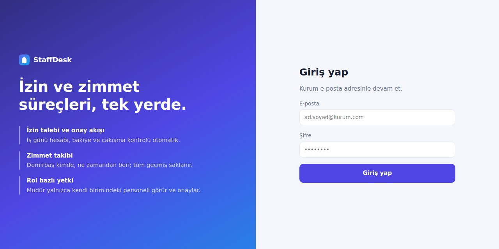

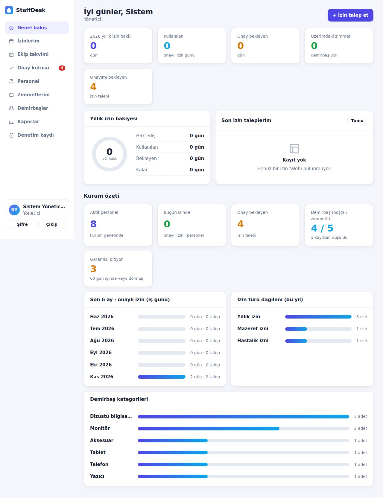

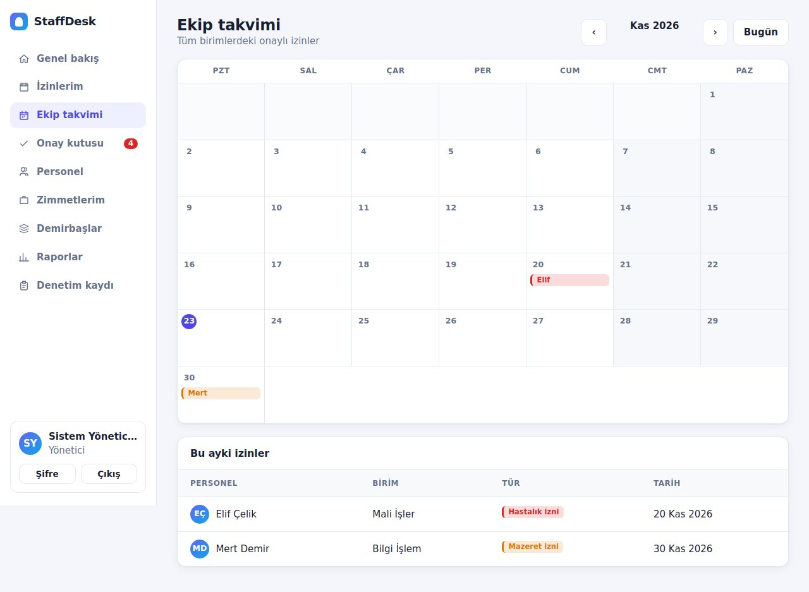

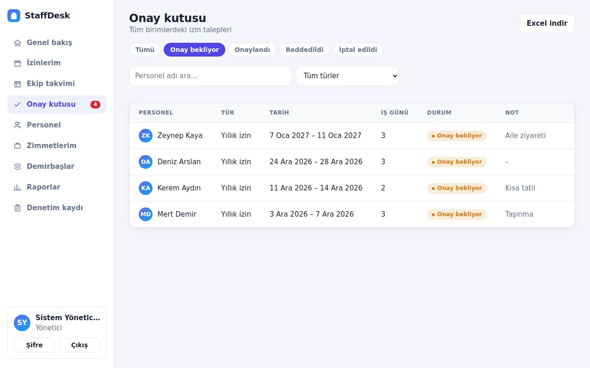

| Personel arama ve süzgeç | Demirbaş envanteri (garanti uyarıları) |
|---|---|
| 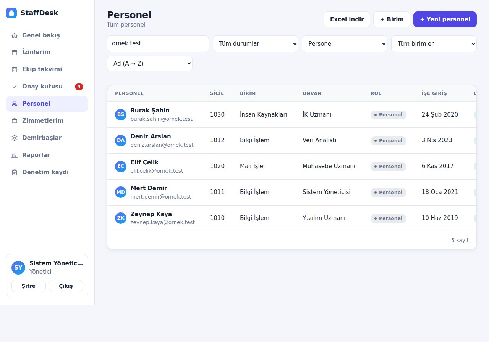 | 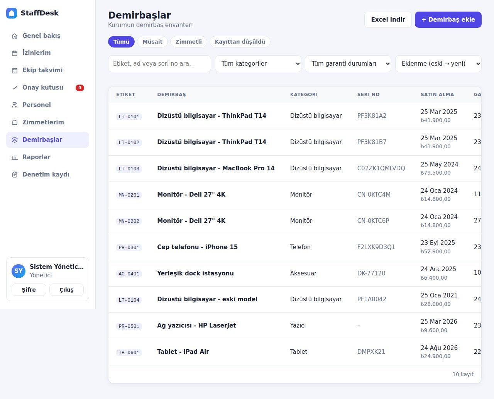 |

| Garantisi yaklaşan demirbaşlar | Demirbaş düzenleme |
|---|---|
| 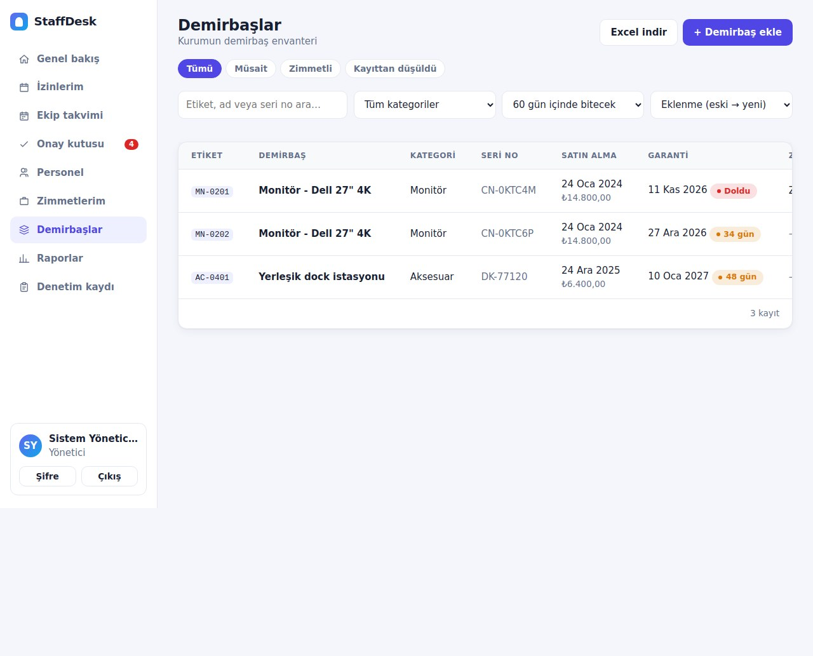 | 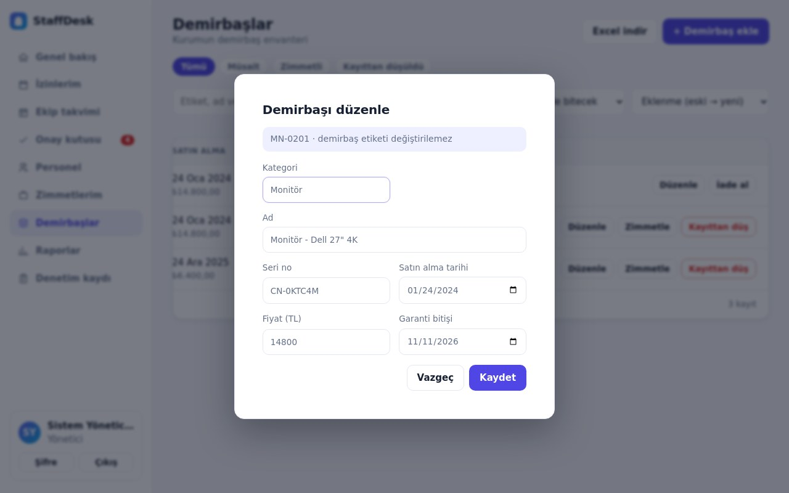 |

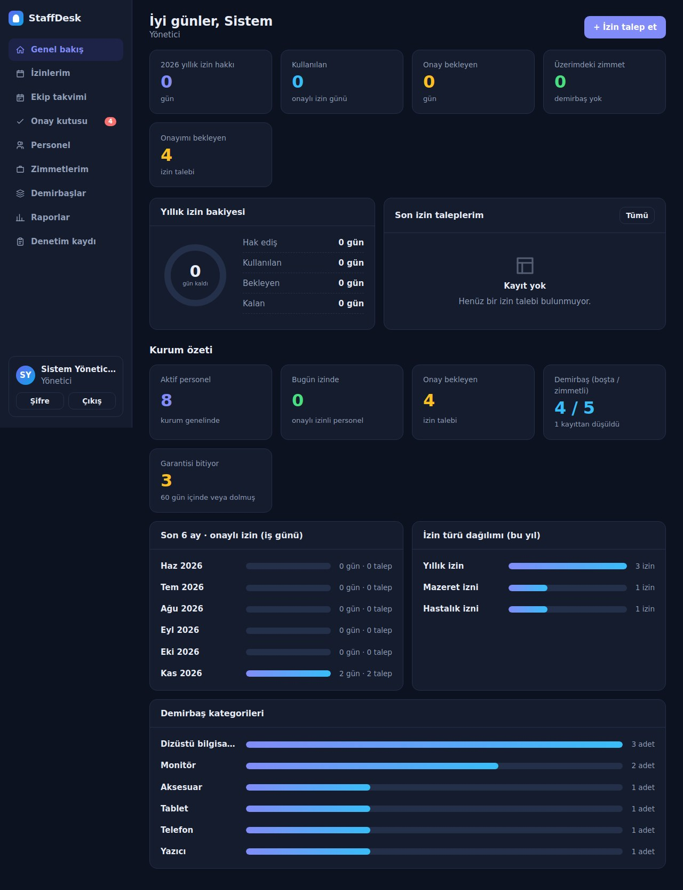

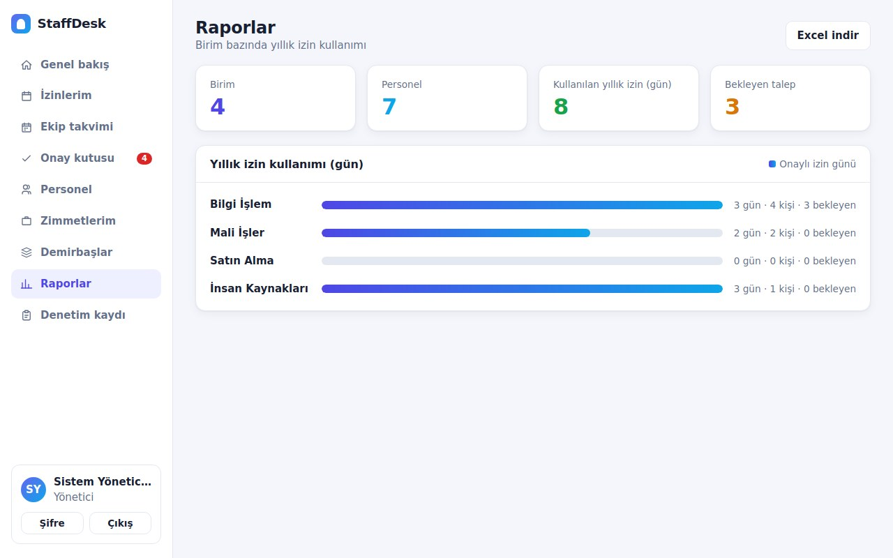

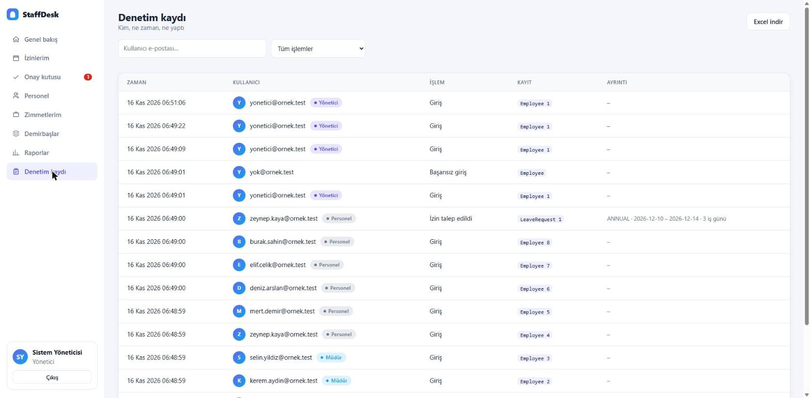

Denetim kaydındaki saatler sunucunun yerel saatidir (Docker'da UTC).

| İzin talebi | Mobil görünüm |
|---|---|
| 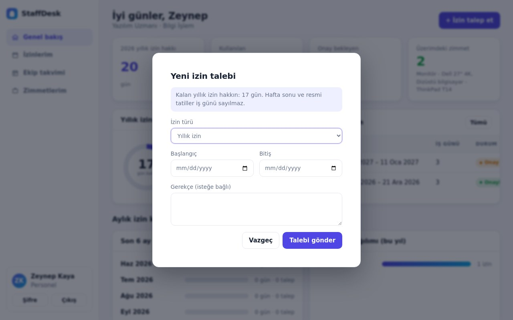 | 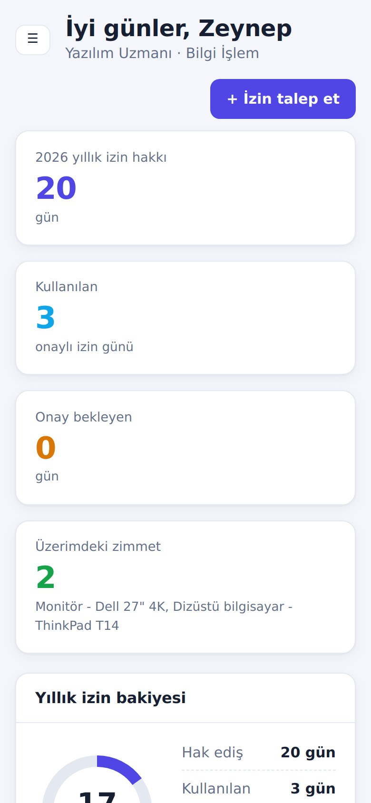 |

**Denemek için:** uygulamayı Docker ile başlatın (aşağıda), ardından demo verisini yükleyin. Betik birimler, yedi personel, farklı durumlarda izin talepleri ve demirbaşlar oluşturur (Node 18+ gerekir):
```bash
ADMIN_EMAIL=<yönetici e-postası> ADMIN_PASSWORD=<yönetici şifresi> node scripts/demo-verisi.mjs
```
Oluşan demo kullanıcılarının (ör. `kerem.aydin@ornek.test` müdür, `zeynep.kaya@ornek.test` personel) ortak şifresi betiğin başında yazar; yalnızca yerel denemede kullanın.

## API ekran görüntüleri

PostgreSQL üzerinde çalışan uygulamanın Swagger arayüzü (demo verisiyle). Sağ üstteki **Authorize** düğmesine `/api/auth/login` ile alınan token girilir:

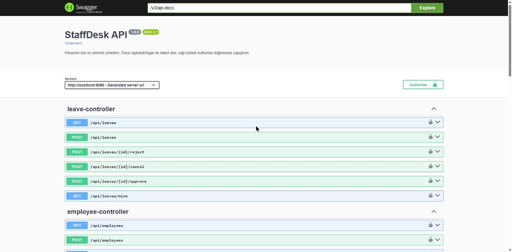

Yönetici olarak çalıştırılan birim bazlı izin kullanım raporu (3 birim, onaylı izin günleri ve bekleyen talepler):

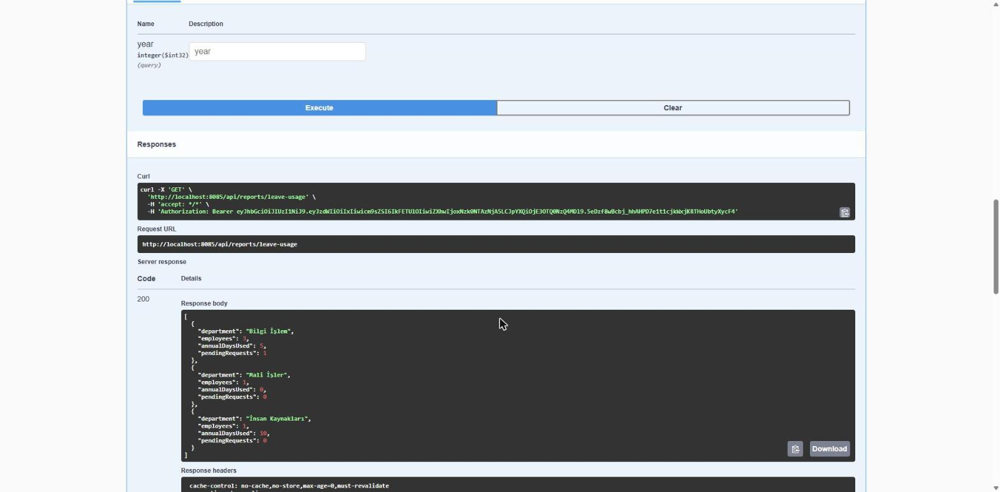
## İş kuralları
| Kural | Ayrıntı |
|---|---|
| Hak ediş (örnek) | Hizmet süresi 1 yıldan az: 0 gün, 1–10 yıl: 20 gün, 10 yıl ve üzeri: 30 gün (kamu personel rejimindeki kademeye benzer örnek kural; kurum mevzuatına göre uyarlanmalıdır) |
| İş günü | Cumartesi/Pazar ve `staffdesk.holidays` içindeki tarihler sayılmaz (dini bayramlar her yıl eklenmelidir) |
| Yıllık izin | Geçmiş tarih için talep edilemez; kalan bakiye (hak − onaylı − bekleyen) aşılamaz |
| Hastalık izni | En fazla 30 gün geriye dönük bildirilebilir |
| Çakışma | Bekleyen/onaylı izinle çakışan talep reddedilir |
| Durum akışı | `PENDING → APPROVED / REJECTED / CANCELLED`; yalnızca bekleyen talep üzerinde işlem yapılır |
| Zimmet | `AVAILABLE → ASSIGNED → AVAILABLE`, `AVAILABLE → RETIRED` |

## Veritabanı şeması

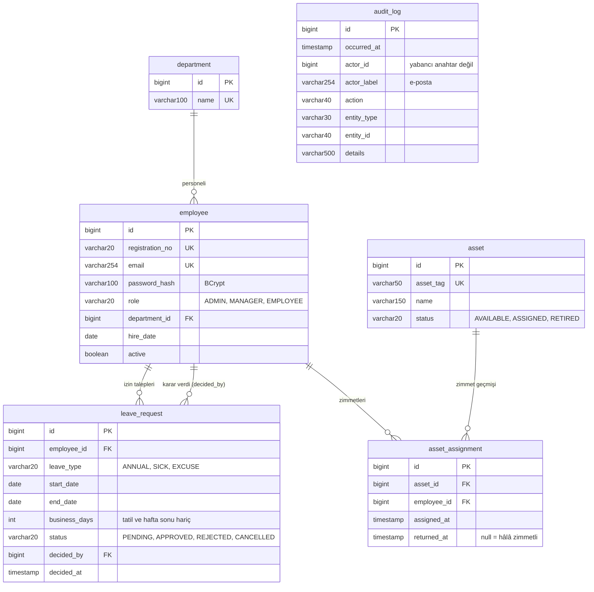

`audit_log`, `employee` ile yabancı anahtarla bağlı değildir: işlemi yapanın e-postası kayıt anında metin olarak yazılır (başarısız girişte var olmayan bir e-posta da yazılabilir; personel pasife alınsa bile geçmiş kaydı anlamını korur). Şema yalnızca Flyway migrasyonlarıyla (`db/migration/V1..V3`) yönetilir.

## Mimari
```
api/         Controller'lar, DTO'lar, merkezi hata yönetimi (ProblemDetail), CurrentUser
service/     İş kuralları: LeaveService, AssetService, EmployeeService, AuthService, ReportService,
             saf hesaplayıcılar (LeaveEntitlementCalculator, BusinessDayCalculator), AccessPolicy
domain/      JPA varlıkları ve durum makineleri (LeaveRequest, Asset, ...)
repository/  Spring Data JPA arayüzleri (JPQL sorguları, satır kilidi)
config/      Güvenlik (JWT), ayarlar (@ConfigurationProperties), ilk yönetici
db/migration Flyway SQL migrasyonları
```

Tasarım kararları:
- **Şema yalnızca Flyway ile yönetilir**, Hibernate `ddl-auto: validate` ile eşleşmeyi doğrular. Migrasyon SQL'i taşınabilir olduğundan testler H2'de (PostgreSQL kipi), üretim PostgreSQL'de çalışır.
- **Eşzamanlılık:** zimmetlemede demirbaş satırı `PESSIMISTIC_WRITE` ile kilitlenir.
- **Zaman bağımlılığı** (`Clock`) enjekte edilir; testler tarihi sabitleyerek deterministik çalışır.
- **Yetki iki katmanlıdır:** uç nokta düzeyinde `@PreAuthorize`, kayıt düzeyinde `AccessPolicy` (birim kapsamı).
- Entity'ler API'ye doğrudan açılmaz (DTO kullanılır); `open-in-view` kapalıdır.

## API özeti
| Yöntem | Yol | Yetki |
|---|---|---|
| POST | `/api/auth/login` | herkese açık |
| POST/GET | `/api/departments` | ADMIN / giriş yapmış |
| POST/GET | `/api/employees` | ADMIN / ADMIN, MANAGER |
| GET | `/api/employees/me`, `/api/employees/{id}` | kendisi, yönetici, birim müdürü |
| GET | `/api/employees/{id}/leave-balance?year=` | kendisi, yönetici, birim müdürü |
| GET | `/api/employees?q=&departmentId=&active=&role=&sort=&desc=&page=&size=` | ADMIN, MANAGER (birim kapsamlı) |
| PATCH | `/api/employees/{id}` (ad, unvan, birim, rol) | ADMIN |
| PATCH | `/api/employees/{id}/activate`, `/deactivate` | ADMIN |
| POST | `/api/auth/change-password` | giriş yapmış (kendi şifresi) |
| GET | `/api/dashboard` | giriş yapmış (kapsam role göre: ALL / DEPARTMENT / SELF) |
| GET | `/api/leaves/calendar?month=yyyy-MM` | giriş yapmış (onaylı izinler, birim kapsamlı) |
| POST | `/api/leaves` | giriş yapmış (kendi adına) |
| GET | `/api/leaves/mine?page=&size=` | giriş yapmış (sayfalı, en yeni başlangıç önce) |
| GET | `/api/leaves?status=PENDING\|APPROVED\|…\|ALL&type=&employeeId=&q=&from=&to=` | ADMIN, MANAGER (birim kapsamlı) |
| POST | `/api/leaves/{id}/approve`, `/reject` (isteğe bağlı `{"note": "..."}` gerekçesi) | ADMIN, MANAGER |
| POST | `/api/leaves/{id}/cancel` | talep sahibi |
| POST | `/api/assets` (seri no, satın alma, fiyat, garanti ile) | ADMIN |
| GET | `/api/assets?q=&category=&status=&warrantyWithinDays=&sort=&desc=`, `/api/assets/categories` | ADMIN, MANAGER |
| PATCH | `/api/assets/{id}` | ADMIN |
| POST | `/api/assets/{id}/assign`, `/return`, `/retire` | ADMIN |
| GET | `/api/employees/{id}/assets` | kendisi, yönetici, birim müdürü |
| GET | `/api/reports/leave-usage?year=`, `/api/reports/leave-usage.xlsx?year=` | ADMIN |
| GET | `/api/audit?actor=&action=&from=&to=&page=&size=` | ADMIN |
| GET | `/api/audit/export.xlsx` (aynı süzgeçler) | ADMIN |
| GET | `/api/exports/employees.xlsx`, `/assets.xlsx`, `/leaves.xlsx` (liste süzgeçleriyle) | ADMIN |

## Çalıştırma
Gereksinimler: Java 21, Maven, PostgreSQL (veya Docker).

```bash
# Docker ile (PostgreSQL dahil)
cp .env.example .env     # DB_PASSWORD, JWT_SECRET ve ilk yönetici bilgilerini doldurun
docker compose up --build   # http://localhost:8080/swagger-ui.html

# Yerelde
export DB_URL=jdbc:postgresql://localhost:5432/staffdesk DB_USER=staffdesk DB_PASSWORD=...
export JWT_SECRET=<en-az-32-karakter> ADMIN_EMAIL=admin@ornek.com ADMIN_PASSWORD=<en-az-8-karakter>
mvn spring-boot:run
```
Veritabanında hiç `ADMIN` yoksa, `ADMIN_EMAIL`/`ADMIN_PASSWORD` ile açılışta ilk yönetici oluşturulur. `JWT_SECRET` yoksa uygulama başlamaz.

## Test ve CI
```bash
mvn verify      # 202 test
```
- Birim testleri: hak ediş hesabı, iş günü hesabı, durum makineleri.
**Kapsam:** `mvn verify` JaCoCo raporunu `target/site/jacoco/index.html` altında üretir. CI satır kapsamını iş akışı özetine yazar ve raporu `jacoco-raporu` artifact olarak yükler.
- Uçtan uca testler (`MockMvc`, gerçek Spring bağlamı + Flyway + H2): kimlik doğrulama, rol/kapsam kontrolleri, izin kuralları (çakışma, bakiye, tatil, geçmiş tarih), onay akışı, zimmet yaşam döngüsü, rapor, doğrulama hataları.
- Denetim kaydı testleri: işlemlerin kullanıcı ve zamanla yazılması, izin akışında talep eden ve karar veren, başarısız girişin denenen e-postayla kaydı ve parolanın kayda girmemesi, yalnızca `ADMIN` erişimi, süzgeç/sayfalama/doğrulama, Excel çıktısında formül enjeksiyonu koruması.
- Arama ve süzgeç testleri (`PersonelAramaTest`, `DemirbasDetayTest`, `IzinSuzgecVeTakvimTest`): `%`/`_` kaçırma, büyük-küçük harf ve Türkçe karakter, sayfalama ve sıralama sınırları, müdürün birim kapsamının süzgeçle aşılamaması, takvimde rol kapsamı ve gerekçenin sızmaması.
- Pano ve hesap testleri (`PanoTest`, `HesapYonetimiTest`, `DisaAktarimTest`): rol kapsamlı sayımlar, aylık/tür/kategori toplulaştırmaları, güncelleme kuralları, şifre değiştirme, Excel içeriği ve denetim kaydı.
- Uygulama ayrıca gerçek PostgreSQL üzerinde (Flyway + Hibernate doğrulaması + rapor ve denetim sorguları + Excel çıktısı) elle denenmiştir.
- GitHub Actions her push ve pull request'te `mvn verify` çalıştırır.

## Bilinen sınırlar / sonraki adımlar
Token yenileme (refresh token) ve oturum kapatma (çıkışta token'ı geçersiz kılma) yok; token süresi dolana kadar kullanılır. Buna karşılık her istekte personelin durumu veritabanından yeniden okunduğu için pasife alınan ya da silinen personelin token'ı hemen reddedilir ve rol değişikliği anında yansır (`ActiveEmployeeJwtConverter`, `deactivatedEmployeesExistingTokenIsRejected` testi). Giriş denemeleri e-posta bazında sınırlıdır (art arda hatalı denemede geçici kilit), ancak sayaç bellekte tutulur ve yalnızca tek uygulama örneği için yeterlidir. Resmi tatiller yapılandırmadan elle girilir (2026 ve 2027 tanımlıdır). Bildirim (e-posta) ve dosya eki (belge) desteği yok; rapor yalnızca Excel olarak alınabilir (PDF yok).

**Denetim kaydının sınırları:** Tablo uygulama tarafında yalnızca eklenir, ancak veritabanı düzeyinde güncelleme/silme engellenmemiştir (üretimde uygulama hesabına yalnızca `INSERT`/`SELECT` yetkisi verilmesi önerilir); saklama/arşivleme politikası yoktur. Giriş olayları ayrı bir işlemde yazılır (başarısız girişte istek hata ile bitse de kayıt kalır). Hız sınırı nedeniyle reddedilen (kilitli) giriş denemeleri kayda alınmaz; okuma istekleri de alınmaz.

## Lisans

Bu proje [MIT Lisansı](LICENSE) ile paylaşılmaktadır.
